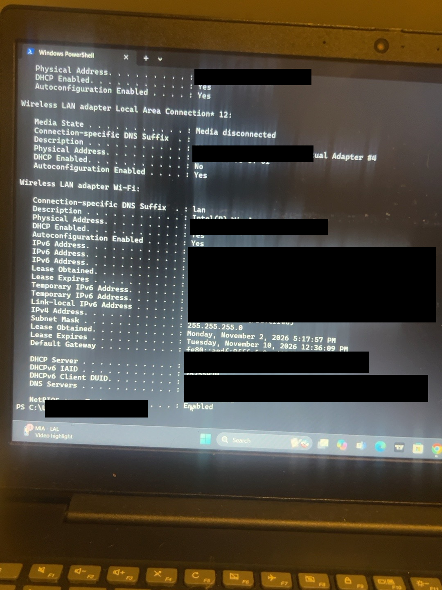

Windows Network Configuration and Troubleshooting Lab

Project Overview

In this project, I used Windows Command Prompt to examine my computer’s network settings, test connectivity, and understand how DNS works.

My goal was to practice basic networking commands used by IT Help Desk technicians when diagnosing connectivity problems.

Tools Used

* Windows Command Prompt
* ipconfig
* ping
* nslookup
* tracert

1. Inspect IP Configuration

Command: ipconfig /all

Purpose: Identify my computer’s network configuration.

My Findings:

* IPv4 Address: 192.168.12.xxx
* Subnet Mask: 255.255.255.0
* Default Gateway: 192.168.12.x
* DHCP Enabled: Yes
* DNS Server: 192.168.12.x

What I Learned:

I learned how to identify my computer’s IP address, subnet mask, default gateway, and DNS settings. DHCP was enabled, meaning my computer was configured to obtain network settings automatically.
### Screenshot: IP Configuration Results

2. Test Network Connectivity

Purpose: Determine whether my computer could communicate with devices on my local network and external networks.

Test A: Default Gateway

Command: ping 192.168.12.x

Results:

* Packets sent: 4
* Packets received: 4
* Packet loss: 0%
* Average response time: 1 ms

Conclusion: My computer successfully communicated with the default gateway.

Test B: External IP Address

Command: ping 1.1.1.1

Results:

* Packets sent: 4
* Packets received: 4
* Packet loss: 0%
* Average response time: 32 ms

Conclusion: My computer successfully received responses from an external IP address without needing DNS resolution.

Test C: Google Domain

Command: ping google.com

Results:

* Packets received: 4
* Successful ICMP replies

Conclusion: My computer successfully resolved the hostname and received responses from the destination.

Additional Connectivity Test

Command: ping 8.8.8.8

Result: Received ICMP replies.

Conclusion: The external IP address responded to my connectivity test.

### Step 2 Conclusion

I used the ping command to test communication between my computer, my default gateway, and external destinations.

All three tests were successful with 0% packet loss. This showed that my computer could communicate with my router, reach an external IP address, and resolve and reach google.com.

I learned that ping helps IT technicians check basic network connectivity. If an external IP address responds but a domain name cannot be resolved, DNS is a possible cause that should be investigated.
### Screenshot: Network Connectivity Test

3. Test DNS Resolution

Command: nslookup google.com

Purpose: Check whether DNS could translate a domain name into IP addresses.

Observed Results:

* Domain: google.com
* IPv4: 142.250.65.xx
* IPv6: 2607:f8b0:4006:804::xxx
* Result: Successful DNS resolution

Conclusion:

DNS successfully returned IPv4 and IPv6 addresses for google.com.
What I Learned:

I learned that DNS translates domain names into IP addresses so computers can find websites and other network destinations.

My test successfully returned IPv4 and IPv6 addresses for google.com, confirming that DNS resolution was working at the time of testing.

If I can ping an external IP address but cannot resolve a website's domain name, I would investigate DNS settings as a possible cause.

4. Trace Network Route

Command: tracert google.com

Purpose: Identify the network hops used to reach the destination.

Results:

* Traceroute completed
* Used IPv6
* Reached the destination in 11 hops

Conclusion:

I learned that tracert helps identify the path network traffic takes toward a destination. It can help technicians investigate where communication delays or failures may occur.

5. Troubleshooting Analysis

The tests showed that:

* My computer had a private IPv4 address and DHCP was enabled.
* My default gateway responded successfully.
* External IP addresses responded to ICMP requests.
* DNS successfully resolved google.com.
* Traceroute completed and showed the network path.

These results showed that the tested network functions were working at the time of testing.

However, successful ping tests do not guarantee that websites or other services are functioning correctly.

What I Learned:

I learned that tracert shows the path network packets take to reach a destination. Each hop represents a network device along the route. IT technicians can use this command to investigate where network connectivity problems might be happening.

6. Lessons Learned

This project helped me understand the difference between IP configuration, network connectivity, and DNS resolution.

I learned that an IT technician should troubleshoot in steps instead of assuming what is wrong.

For example, if a computer can ping an external IP address but cannot resolve a website’s domain name, DNS may be the problem.

I also learned how to use Command Prompt results to document and explain my findings.

8. Project Status

Core network configuration, connectivity, DNS, and traceroute testing completed.

Final Conclusion

In this project, I practiced using Windows Command Prompt to understand and troubleshoot network connectivity.

I used ipconfig /all to examine my computer’s network settings and identify DHCP, DNS, and default gateway information.

I used ping to test communication with my local gateway and external IP addresses. I also used nslookup to verify DNS resolution and tracert to examine the path to a network destination.

My tests showed successful connectivity and DNS resolution at the time of testing.

The biggest lesson I learned is that network troubleshooting should be done step by step. Each command helps identify a different part of the network and narrow down possible problems.

This project helped me build foundational troubleshooting skills that I can continue developing for an entry-level IT Help Desk role.
